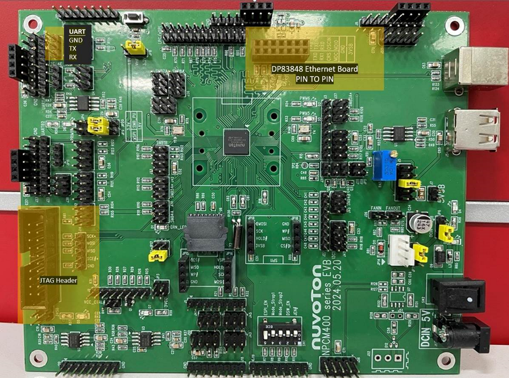

# Nuvoton NPCM400 Evaluation Board



This repository provides support for the Nuvoton NPCM400 Evaluation Board (EVB) within the OpenBIC framework.

## Table of Contents
- [Getting Started](#getting-started)
  - [Prerequisites](#prerequisites)
  - [Building the Project](#building-the-project)
  - [Flash Programming](#flash-programming)
    - [Method 1: J-Link](#j-link)
    - [Method 2: NpcmFwProg](#npcmfwprog)
- [Features & Verification](#features--verification)
  - [OBMF](#obmf)
- [Contact Information](#contact-information)

---

## Getting Started

### Prerequisites
Refer to the [Zephyr Getting Started Guide](https://docs.zephyrproject.org/latest/develop/getting_started/index.html) to set up your development environment.

### Power Supply Configuration
The NPCM400 EVB provides two power supply options, configurable via the **JP6** jumper:
1. **USB Power**: If selected, power must be supplied by connecting a cable to the **USB Type-B** port.
2. **DC IN 5V Power**: If selected, power must be supplied by plugging a **DC 5V Adapter** into the DC IN jack.

### Debug Console (UART)
To view the debug log, connect a UART-to-USB adapter to the UART pins on the board. Please refer to the EVB image at the top of this document for the exact location of the UART header (labeled as UART: GND, TX, RX).

### Building the Project
Run the following command to build the OpenBIC firmware for NPCM400:
```bash
west -z zephyr_nuvoton build -p always -b npcm400f_evb openbic/meta-nuvoton/smc-npcm400-obmf/
```

### Flash Programming

#### J-Link
The NPCM400F supports J-Link flash programming.

1. Copy the [NUVOTON folder][def] to the appropriate directory for your OS:
   - **Windows**: `C:\Users\<USER>\AppData\Roaming\SEGGER\JLinkDevices\`
   - **Linux**: `$HOME/.config/SEGGER/JLinkDevices/`
   - **macOS**: `$HOME/Library/Application Support/SEGGER/JLinkDevices/`

2. Flash the image to your board:
   ```bash
   cp build/zephyr/SMCNPCM_signed.bin build/zephyr/zephyr_signed.bin
   west flash
   ```

#### NpcmFwProg
`NpcmFwProg` is a tool to program firmware over a TTY serial connection. Refer to the [npcmFwProg repository](https://github.com/Nuvoton-Israel/npcmFwProg) for details.
> **Note**: Execute the command `flash erase spi_spim0_cs0 0x0 0x4000` in the SMC console before using the `npcmFwProg` tool to update the SMC firmware.

[def]: https://github.com/Nuvoton-Israel/zephyr/tree/openbic-v2.6/boards/arm/npcm400f_evb/NUVOTON

---

## Features & Verification

### OBMF
For OBMF setup and verification steps, refer to the [OpenBMC NPCM845 EVB OBMF README](https://github.com/Nuvoton-Israel/openbmc/blob/npcm-master/meta-nuvoton-obmc/meta-evb-npcm845/README-OBMF.md).

---

## Contact Information
For product questions or support, please contact:
* **Email**: bmc_marketing@nuvoton.com